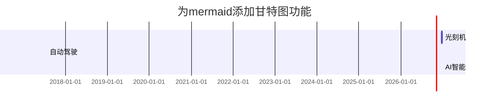

\---  
title: 标题：文章文本与排版  
description: 摘要：这是一个示范文本，方便你对照着使用md文件格式写作。  
author: 作者：王志满  
date: 2026-10-12 22:00:00 +0800 #创建时间，注意时间不要填未来的时间，否则文章无法发布到网站上。  
categories: [网站,文章排版] #分类 注意逗号需使用英文逗号,  
tags: [模板,md文件,文章排版] #标签 注意逗号需使用英文逗号,  
pin: true # true表示文章置顶，留空表示默认按创建时间排序。  
math: #true # ture表示使用 MathJax 来生成数学。留空表示默认不加载，可以提高网站性能。  
mermaid: #true # Mermaid 是一个很棒的图表生成工具，ture表示启用它，留空表示默认不加载。  
image: # 文章首图和分享缩略图 # 设置图片属性。  
  path: /commons/devices-mockup.png #图片地址 # lqip 表示 用极低分辨率、高压缩的图片（通常 1–5KB）当占位，原图加载完再替换，视觉上更平滑。  
  lqip: data:image/webp;base64,UklGRpoAAABXRUJQVlA4WAoAAAAQAAAADwAABwAAQUxQSDIAAAARL0AmbZurmr57yyIiqE8oiG0bejIYEQTgqiDA9vqnsUSI6H+oAERp2HZ65qP/VIAWAFZQOCBCAAAA8AEAnQEqEAAIAAVAfCWkAALp8sF8rgRgAP7o9FDvMCkMde9PK7euH5M1m6VWoDXf2FkP3BqV0ZYbO6NA/VFIAAAA  
  alt: 文章首图和分享缩略图 # alt表示图片替代文本，通常用于描述图片内容，当图片加载异常会显示该文本。  
\---

## 标题示例

# 这两行代码即第19、20行代码，以及第32行代码，共同组合使用，表示第21-31行可以随意写，规则全部关闭。

# 一级标题

{: .mt-4 .mb-0 } # 效果为：一级标题上方留出约 1rem 间距，下方不留间距。‌‌ # 网页设计里的rem是CSS样式单位，用来设置字体或元素尺寸，和根元素大小挂钩。

## 二级标题

{: data-toc-skip='' .mt-4 .mb-0 } # data-toc-skip=''表示一个‌HTML自定义属性‌，告诉TOC生成脚本“跳过这个二级标题，不要把它放进目录里”。 它本身是空的，只要存在这个属性就生效，不需要赋值。‌‌

### 三级标题

{: data-toc-skip='' .mt-4 .mb-0 }

#### 四级标题

{: data-toc-skip='' .mt-4 }

# 和第19、20行代码组合使用。

## 段落

第一段。这一行可以一直写，都属于第一段。网页会自动换行。

第二段。段与段之间需隔一行空行，表示下一段内容。否则还是属于同一段。

## 列表

### 编号列表

1. 第一
2. 第二
3. 第三

### 多级编号

- 第一章
  - 第一节
    - 第一段

### 待办清单

- [ ] 待办
  - [x] 第一步
  - [x] 第二步
  - [ ] 第三步

### 注释

太阳  
: 地球绕其运行的恒星。

月亮  
: 地球的天然卫星，通过太阳反射光可见。

## 引用

> 这条线显示了 *块状引文*。

## 提示

> 这是一个展示 `tip` 类型的示例。  
> {: .prompt-tip }

> 这是一个展示 `info` 类型的示例。  
> {: .prompt-info }

> 这是一个展示 `warning` 类型的示例。  
> {: .prompt-warning }

> 这是一个展示 `danger` 类型的示例。  
> {: .prompt-danger }

## 表格

| 企业名称    | 联系人  | 国家 |
| :------ | :--- | -: |
| 农家乐有限公司 | 张三   | 中国 |
| 丰地株式会社  | 松下三郎 | 日本 |
| 微硬公司    | 乔治   | 美国 |

## 网址

md文件源代码示例<https://github.com/cotes2020/jekyll-theme-chirpy/blob/master/\_posts/2019-08-08-text-and-typography.md?plain=1>

文本与排版效果<https://chirpy.cotes.page/posts/text-and-typography/#headings>

## 脚注

点击可以跳转到脚注[^脚注1]，这是另一个脚注[^脚注2]。

## 代码高亮

这是一段突出显示的 `高亮代码`。

## 文件路径

这是 `/path/to/the/file.extend`{: .filepath}.

## 代码块（有复制按钮，方便读者复制）

### 纯文本代码

```
这是一段常见的代码片段，没有语法高亮和行号。
```

### 特定编程语言

```bash
if [ $? -ne 0 ]; then
  echo "程序运行失败。";
  #do the needful / exit
fi;
```

### 特定文件名

```sass
@import
  "colors/light-typography",
  "colors/dark-typography";
```

{: file='\_sass/jekyll-theme-chirpy.scss'}

## 数学

该数学公式由 [**MathJax**](https://www.mathjax.org/)生成:

$$
\begin{equation}
  \sum_{n=1}^\infty 1/n^2 = \frac{\pi^2}{6}
  \label{eq:series}
\end{equation}
$$

我们可以将该方程引用为 \eqref{eq:series}.

当 $a \ne 0$, 则有两个解 $ax^2 + bx + c = 0$ 具体为

$x = {-b \pm \sqrt{b^2-4ac} \over 2a}$

## Mermaid SVG 一种基于文本的图表描述语言



## 图片

### 默认 (附说明)


{: width="972" height="589" }  
*让内容占满整个屏幕宽度，同时在页面上水平居中显示*

### 左对齐


{: width="972" height="589" .w-75 .normal}

### 向左浮动


{: width="972" height="589" .w-50 .left}  
人之初，性本善。性相近，习相远。苟不教，性乃迁。教之道，贵以专。昔孟母，择邻处。子不学，断机杼。窦燕山，有义方。教五子，名俱扬。养不教，父之过。教不严，师之惰。子不学，非所宜。幼不学，老何为。玉不琢，不成器。人不学，不知义。为人子，方少时。亲师友，习礼仪。香九龄，能温席。孝于亲，所当执。融四岁，能让梨。悌于长，宜先知。首孝悌，次见闻。知某数，识某文。一而十，十而百。百而千，千而万。三才者，天地人。三光者，日月星。三纲者，君臣义。父子亲，夫妇顺。曰春夏，曰秋冬。此四时，运不穷。曰南北，曰西东。此四方，应乎中。曰水火，木金土。此五行，本乎数。十干者，甲至癸。十二支，子至亥。曰黄道，日所躔。曰赤道，当中权。赤道下，温暖极。我中华，在东北。曰江河，曰淮济。此四渎，水之纪。曰岱华，嵩恒衡。此五岳，山之名。曰士农，曰工商。此四民，国之良。

### 向右浮动


{: width="972" height="589" .w-50 .right}  
人之初，性本善。性相近，习相远。苟不教，性乃迁。教之道，贵以专。昔孟母，择邻处。子不学，断机杼。窦燕山，有义方。教五子，名俱扬。养不教，父之过。教不严，师之惰。子不学，非所宜。幼不学，老何为。玉不琢，不成器。人不学，不知义。为人子，方少时。亲师友，习礼仪。香九龄，能温席。孝于亲，所当执。融四岁，能让梨。悌于长，宜先知。首孝悌，次见闻。知某数，识某文。一而十，十而百。百而千，千而万。三才者，天地人。三光者，日月星。三纲者，君臣义。父子亲，夫妇顺。曰春夏，曰秋冬。此四时，运不穷。曰南北，曰西东。此四方，应乎中。曰水火，木金土。此五行，本乎数。十干者，甲至癸。十二支，子至亥。曰黄道，日所躔。曰赤道，当中权。赤道下，温暖极。我中华，在东北。曰江河，曰淮济。此四渎，水之纪。曰岱华，嵩恒衡。此五岳，山之名。曰士农，曰工商。此四民，国之良。

### 暗黑/明亮模式和阴影效果

下面的图片会根据主题偏好自动切换暗黑/明亮模式，并且显示阴影效果。需要自行制作两种模式的图片，这里我偷懒就随便放两张不同的图片，仅作示范。


{: .light .w-75 .shadow .rounded-10 w='1212' h='668' }  


{: .dark .w-75 .shadow .rounded-10 w='1212' h='668' }

## Video



## Reverse Footnote

[^footnote]: The footnote source

[^fn-nth-2]: The 2nd footnote source
